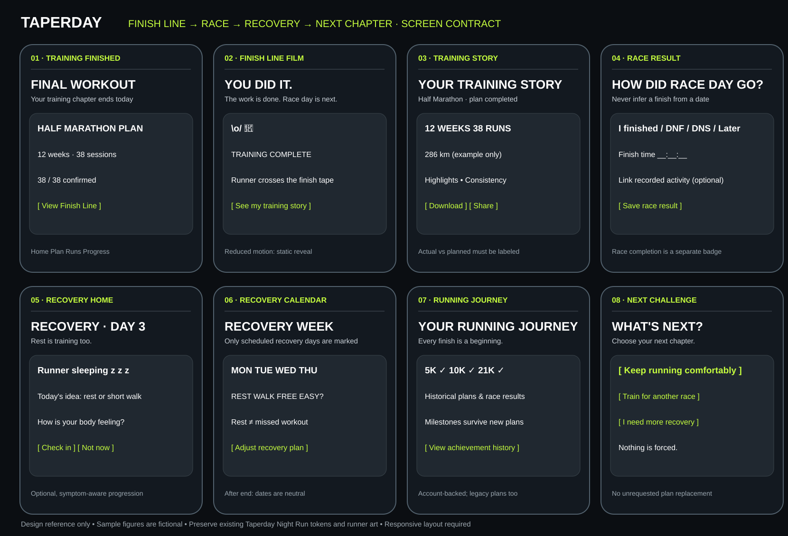
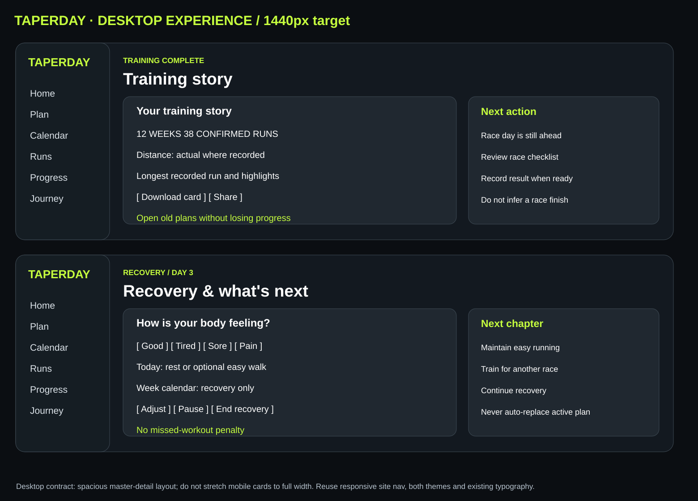

# Finish Line visual implementation contract

These are **original vector reference diagrams committed to PR #262**, not screenshots of the running application and not ready-made components. Illustrative values (weeks, runs, distances) are fictional.

## Visual priority and style guardrails

1. **Existing Taperday is the source of truth**: preserve its Night Run palette, brand colours, fonts, spacing conventions, original cartoon Runner art, existing animated site intro and supported light/dark modes. The storyboards communicate **layout and UX**, not permission to introduce a new look, fake metrics, extra navigation or third-party illustrations.
2. Phone: one clear primary action per viewport, meaningful bottom navigation, safe-area padding, max 320px viewport baseline, readable text and minimum 44px touch targets.
3. Tablet/desktop: keep the site's existing navigation and use deliberate two-column master-detail arrangements where useful, not an artificially stretched mobile screen. Long captions must wrap, charts adapt, charts include accessible equivalents.
4. Prefer existing primitives, design tokens and motion utilities. Only add animation where it serves the milestone; preserve the original runner. Do not add heavyweight animation UI libraries just to reproduce these illustrations.
5. Support keyboard navigation, focus-visible, assistive labels, reduced motion and high contrast in both themes. Do not lock users into a non-dismissible celebration.

## Screens and required states

| Screen | Main content | Primary action | Critical alternative |
|---|---|---|---|
| Training complete | Last workout confirmed; progress and chapter ending | View Finish Line | Incomplete: recap only, no badge |
| Finish Line film | Runner crosses tape; "YOU DID IT" | See my training story | Reduced motion static, replay, dismissal |
| Training story | Confirmed workouts, actual vs estimated distance, consistent long-run metrics, highlights | Share or download | Missing/expired Strava data explicitly unknown |
| Race result entry | Race status, time, distance, optional linked run | Save race result | DNF, DNS, later, edit and undo |
| Race celebration | Own distinct medal moment and goal comparison | Review results | Never infer result from race date |
| Recovery home | Sleep/rest runner, day count, feeling prompt, gentle activity | Check in | Skip, pause, extend and pain/safety guidance |
| Recovery calendar | Only truly prescribed recovery/rest days marked | Open day, adjust recovery | Outside recovery range blank/neutral; unplanned activity still shown |
| Running journey | Historical achievements, archive, chronology | View chapter | No history and offline states |
| Maintenance | Low-pressure flexible schedule | Start maintenance | No race date required |
| Next challenge | Maintain, build new race, more recovery | Choose explicitly | No automatic replacement of saved active plan |

## Animation storyboard: 5 beats

- **Beat 1:** Existing runner enters from the left on the Taperday course, respecting `prefers-reduced-motion`.
- **Beat 2:** Runner crosses a clear finish tape; do not play this for race completion unless the user actually confirmed finishing the race.
- **Beat 3:** Short celebration with existing volt accents and tasteful particles; avoid seizure-triggering flashes, full-screen rapid flicker or unexpected sound.
- **Beat 4:** Reveal "YOU DID IT" and actual saved metrics progressively. Never imply '21.1 KM CONQUERED' merely from completing a half-marathon *training plan*.
- **Beat 5:** Explicit "See my training story" and optional share/replay. Keep progression accessible if animations don't run, fail or are interrupted.

Motion durations are implementation targets, not fixed brand rules: ~0.6–1.5 seconds for the runner/tape, ~0.4–0.8 seconds for the text reveal. Do not reintroduce pause/next-tip controls that were previously removed from the plan-building film. The user must be able to skip and replay the special moment.

## Calendar state specification

The last scheduled training session, the actual race date, and the *end of the calendar week* are not interchangeable:
- Workout on a plan date: show workout; status reflects manual/confirmed/temporary evidence correctly.
- No workout **inside** the plan: Rest.
- Date **before the start or after the actual end date**: neutral/unmarked **Outside this plan**. No fake rest days.
- Actual race day: race marker, not a training-run completion.
- Unplanned recorded activity: retain a recorded marker without inventing a workout.
- Recovery days: derive only from an explicitly accepted recovery schedule. Past recovery end date stays neutral.
- Out-of-plan day details, tooltips, weekly strip and monthly calendar must agree, even for a custom start date, moved workouts and shortened plans.

## Recovery safety and language

Never state a date makes the runner ready, or prescribe aggressive return. Explicit readiness check-ins gate progression; pain/illness/other red flags lead to safe guidance rather than a harder run. Rest days are positive; no negative streak, missed workout badge or forced completion checkbox.

## Required screenshots for final PR

Use browser tests to capture **real implementation**, not this concept:
- Mobile light and dark: training completion, film, story, result, recovery home/check-in/calendar, journey, maintenance/next-step.
- Desktop light and dark: story, recovery and journey at 1024/1440 widths.
- Key edge cases: race not run, incomplete training, cancelled animation, data unavailable, missing Strava permissions, plan ended mid-month, recovery ended mid-week, pain check-in, very long race names.
- Include screenshot paths and real browser verification notes. No simulated pass claims.

## Handoff order

1. Read [full feature specification](../finish-line-recovery-handover.md).
2. Read these two SVG diagrams and the rules above.
3. Inspect the current code and user's current Night Run UI.
4. Code and test feature slices in this PR, without overriding previously approved style.
5. Attach actual validation screenshots; finish every acceptance item or mark the remaining item explicitly blocked.
