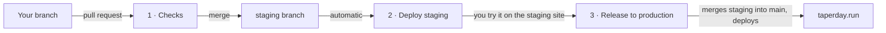

# How we ship

One page for anyone new. A change reaches runners in three steps, and only the last one needs a person to press a button.

## The three steps

| Step | What you do | What runs (name in the Actions tab) | How long |
|---|---|---|---|
| 1 | Open a pull request into `staging` | **1 - Checks** and **1 - Secret scan** | Up to 40 minutes; Playwright is the slow part |
| 2 | Merge the pull request once the checks are green | **2 - Deploy staging** deploys the staging site and smoke-checks it | About 5 minutes |
| 3 | Try it on staging, then press the release button | **3 - Release to production** merges `staging` into `main`, deploys and smoke-checks taperday.run | About 5 minutes |

- **Staging site:** `https://icy-grass-0c32e680f-staging.eastus2.1.azurestaticapps.net`. It has its own empty database and no email, Strava or push settings, so nothing you do there reaches a real runner.
- **The release button:** Actions → **3 - Release to production** → Run workflow, on `main`. It refuses if staging hasn't passed its deploy and smoke check for that exact commit.
- **Several changes can wait on staging together.** One release ships all of them.

## Rules

1. **Pull requests go to `staging`, never to `main`.**
2. **Merge only when all four checks are green:** `backend`, `frontend`, `end-to-end (Playwright)` and `gitleaks`.
3. **Production changes only through the release button.** A push to `main` deploys nothing.
4. **Keep database migrations additive.** They run before the new API starts: add columns and tables now, drop old ones in a later release.

## When something goes red

| What failed | What to do |
|---|---|
| A check on your pull request | Open the failed job, read the first error, fix it on your branch and push. The checks run again by themselves. |
| A test you didn't touch | It may be flaky. Re-run the failed job once (Re-run failed jobs). If it fails again, it's real. |
| **2 - Deploy staging** | Staging is broken but production is untouched. Fix forward with a new pull request. |
| **3 - Release to production**, before the deploy | Nothing changed. Read the message: usually staging hasn't finished its own check yet, or `staging` and `main` conflict. |
| **3 - Release to production**, during or after the deploy | Open the run, copy the red step's name and error, and see [deploy.md](deploy.md#investigating-a-failed-deploy). |

**Urgent fix straight to `main`:** merge it, then run Actions → **Ops - Redeploy production** by hand. Merge `main` back into `staging` afterwards so the two don't drift.

## Everything in the Actions tab

The numbered ones are the pipeline. The rest keep the service running and never ship code by themselves.

| Name in Actions | File | When it runs | What it's for |
|---|---|---|---|
| 1 - Checks | `ci.yml` | Every pull request; pushes to `staging` and `main` | Backend tests, client lint, typecheck and tests, Playwright |
| 1 - Secret scan | `secret-scan.yml` | Every pull request; pushes to `main` | Stops passwords and keys being committed |
| 2 - Deploy staging | `deploy-staging-only.yml` | Every push to `staging` | Deploys and smoke-checks the staging site |
| 3 - Release to production | `release.yml` | By hand | The only road to production |
| Ops - Redeploy production | `deploy.yml` | By hand | Deploys `main` again, as it is |
| Ops - Release email | `announce.yml` | After a release | Switches on the queued "what's new" email, once ([email.md](email.md)) |
| Ops - Dependency doctor | `deps-doctor.yml` | Daily | Pins vulnerable packages and refreshes Dependabot's pull requests |
| Ops - Wake API for weekly recap | `recap-wake.yml` | Sunday evening to Monday | Keeps the API awake so the weekly email sends |
| Ops - Two-hour PWA push test | `push-test.yml` | By hand | Sets up a test notification for one account |
| Shared - Deploy one environment | `deploy-environment.yml` | Never by itself | The deploy recipe that steps 2 and 3 and the redeploy all call |

The file names are older than the names shown in Actions. They stay as they are because the release button finds the staging deploy by its file name.

## Not set up yet

- **Branch protection.** `main` and `staging` accept direct pushes today. Protecting them (Settings → Branches) would enforce rules 1 to 3 and let GitHub merge a pull request by itself when its checks pass.
- **Faster checks.** Playwright runs on one machine. Splitting it across several would bring step 1 down to about 10 minutes.

More detail on accounts, settings and Azure: [deploy.md](deploy.md). Tests: [testing.md](testing.md).
