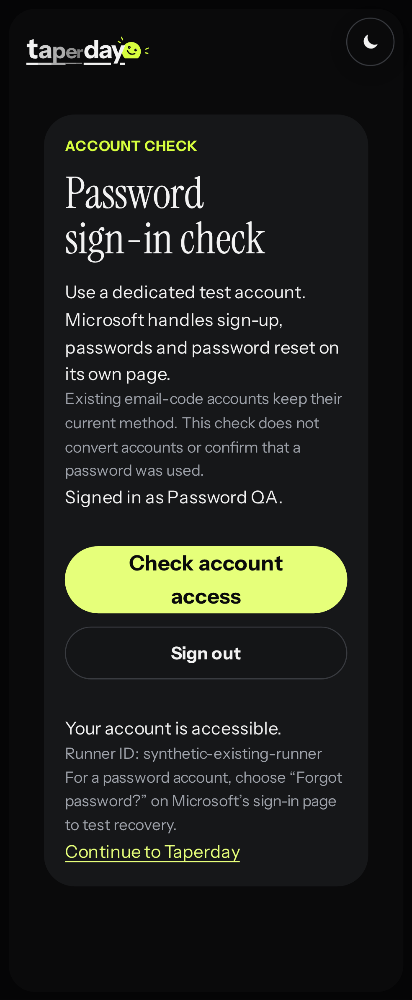
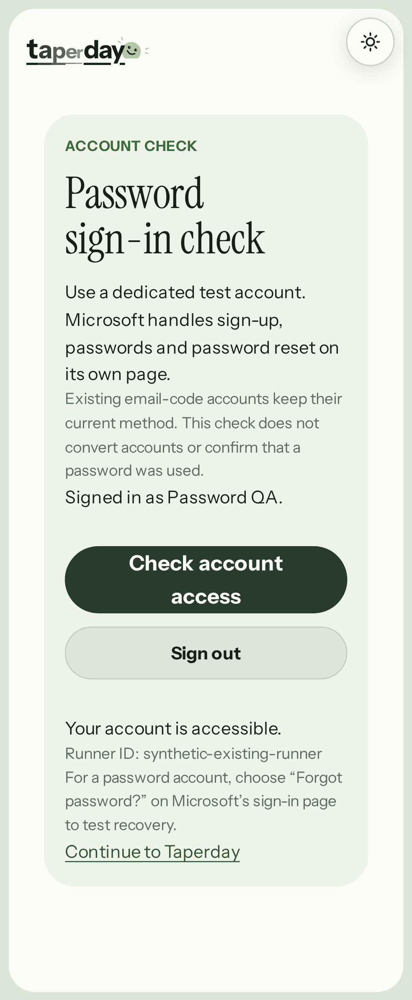

# Password sign-in and production checks

Continue from the [current release completion handover](qa/2026-11-24/master-regression-acceptance.md#current-completion-handover-26-november-2026)
and update the [existing results ledger](qa/2026-11-24/master-qa-results.md). This guide supplies #327's concrete setup
steps; the handover maps remaining work to open #327, merged #326 and the original acceptance criteria.

This implements the isolated password-check and provisioning part of the
[Release Readiness Page](https://chatgpt.com/space/page_4e0cdceb0e188191b8f7265ba9eb9f8e).
The owner authorised production testing while staging SQL is paused. Use a dedicated test identity.

## Implemented behavior

`scripts/entra-passwords.mjs` verifies the production SPA and its current Microsoft user flow. It defaults to read-only.
`--create` prepares a new, **unassigned** password flow, preserving attributes, extensions, Google and other federation.
It does not change the current application's flow, edit users, reset credentials, alter MFA/Conditional Access or grant
permissions. A matching unassigned candidate is reused; ambiguous bindings and modified candidates fail closed.
An uncertain write is never replayed automatically.

`/password-check.html` uses a separately configured Microsoft SPA against the existing API. The main app keeps its client
and callback. Missing, invalid or reused client configuration disables the check. Credentials stay on Microsoft's pages.
The check only calls `GET /api/v1/me` on a deliberate tap and shows the authenticated runner ID for identity comparison.
It cannot create or link a runner, change a password, upload a run or connect Strava. Stalled work is bounded and cancelled
on account/session changes. No token or credential is displayed.

**An email-code account can't be given a password.** Changing the user flow affects new customers; existing customers
keep their original method (on the password flow, an email-code address still gets a code). Tested on 27 November 2026
with a disposable email-code account: Graph refuses both adding a password identity and swapping the email-code identity
for one ("Adding a non-federated user signInType is not permitted if the user only has social/federated identities …
Please recreate the user"). So existing runners move by getting a new Microsoft account, and their runner row is pointed
at it. See [Moving existing email-code runners](#moving-existing-email-code-runners). Never link accounts by email in
the app.

## Tenant administrator steps

Use Node 22+ and Azure CLI signed into the **External ID customer tenant**. Inspection requires `Application.Read.All`
and `EventListener.Read.All`. Creation requires `EventListener.ReadWrite.All` and an appropriate role, such as External ID
User Flow Administrator. Use an owner-approved admin client; do not grant these permissions to Taperday's SPA, API or
GitHub deployment identity. The script consumes the CLI credential in memory. Never paste tokens/passwords into chat.

Inspect first, using the production website application's client ID:

```bash
node scripts/entra-passwords.mjs --tenant EXTERNAL_TENANT_GUID --app PRODUCTION_WEB_CLIENT_GUID
```

Review the source flow, providers and proposed metadata, then prepare the unassigned candidate:

```bash
node scripts/entra-passwords.mjs --tenant EXTERNAL_TENANT_GUID --app PRODUCTION_WEB_CLIENT_GUID --create
```

The output contains tenant flow metadata; keep it private unless reviewed for sharing. If a creation response is uncertain,
inspect the tenant before retrying. The original implementation session had no tenant-admin identity or GitHub
environment-variable write access. Claude must check its own authorised session; the PR handover reports Entra access.
Do not inherit the old environment's restriction as a permanent blocker or broaden permissions to bypass an actual denial.
Use existing owner approval where it covers the concrete change; prepare any uncovered administrator/deployment change
and rollback for review. Administrative access does not itself authorise main-flow activation or customer migration.

Register a separate **Taperday password check** SPA in that same tenant, with the exact callback
`https://taperday.run/password-check.html`. Authorise the same delegated production API scope as the main website.
Associate **only the check app** with the candidate. Keep the main app's current binding. Enable and verify customer
self-service password reset through Microsoft's documented tenant settings; keep required MFA/Conditional Access in force.

Set production's `VITE_AUTH_PASSWORD_CHECK_CLIENT_ID` to the check application's client ID, then deploy the reviewed code
through an owner-approved production test release. The existing client, authority and scope settings remain as configured.
`VITE_AUTH_PASSWORDS` changes explanatory copy only; it does not enable password authentication.

Record setup-code review, the actual pilot deployment, provider/device acceptance and activation as separate gates.
The check page must be present on the real test build; an unmerged branch or local fixture cannot prove production
authentication. If a setup-only promotion is needed for the pilot, prepare that exact reviewed build and rollback with
ordinary sign-in unchanged, using the documented shipping path and the owner's existing controlled-test scope. Keep
the existing-account-upgrade and full-rollout gates open while performing the pilot.

## Live acceptance

Use `/password-check.html` in a separate/private browser session to protect a runner's unsynced drafts.

1. Create a fresh test identity. Confirm Microsoft's page really collects and accepts a password; a successful redirect
   alone does not prove the authentication method. The previous hosted signup error must not recur.
2. Sign out, use the password again, then exercise an incorrect password and cancel/back. Check native password-manager
   AutoFill on actual phones; Taperday does not implement a biometric prompt.
3. Use Microsoft's **Forgot password?** flow, receive the code in the dedicated inbox, set a new password and sign in.
   Verify Google still works where configured.
4. Check API access. A new identity without a Taperday profile must report setup required, without creating/linking a runner.
   For an existing password-backed test identity, compare its exact runner ID and history before/after password reset.
5. Check an existing OTP-only identity using its original method. Its `oid`, runner ID, plans, history and connection keys
   must stay unchanged. Record this as compatibility, not a completed password migration.
6. Repeat expiry/relaunch/logout on actual installed iPhone and Android PWAs. Record provider/device evidence in the Page.

Only after acceptance may the owner assign the main web app to the candidate for **new registrations**. Record the old
flow/app IDs first. If signup or Google fails, restore the previous main-app binding. Keep a used password flow available
to password customers; never delete user objects as rollback. Removing the check client variable and redeploying disables
the check page. Deleting an unused unassigned candidate is a separate administrator action.

## Moving existing email-code runners

Taperday finds a runner by the Microsoft object ID in the token (`Runners.IdentitySubject`). Plans, runs, check-ins,
Strava and devices hang off the runner row, so pointing that one column at a new account moves everything.

For each runner, with the tenant admin account:

1. **Free the email on the old account, without deleting it.** Keep a copy of its identities, `mail` and
   `accountEnabled`. Set its identities to the `userPrincipalName` one only, `mail` to
   `retired-<old object id>@<tenant>.onmicrosoft.com` and `accountEnabled` to false. `mail` can't be blank, and the old
   address stays on the old object as a secondary proxy address, which is harmless.
2. **Create the new account** with the same display name, a long random password nobody keeps,
   `passwordPolicies: DisablePasswordExpiration`, and two identities for the same email: `emailAddress` (issuer = the
   tenant domain) and `federated` (issuer `mail`). Don't set `mail`: the old object still holds the address as a proxy, so
   Graph refuses it ("same value for property proxyAddresses"). The app falls back to the stored email when the token has
   none. Both sign-in methods keep working on the new account, so it's safe to do before the switch-over.
3. **Point the runner at it.** Put the pairs, one `old-object-id new-object-id` per line, in the production environment
   secret `RUNNER_IDENTITY_MOVES`. Run **Actions → Ops - Move runner sign-in** with `check`, then `apply`. All pairs move in
   one transaction; a pair that doesn't match exactly one runner stops the run and nothing changes. The log never shows
   an ID.
4. The runner is signed out once on every device (the old account's sessions end). They sign in with their email, tap
   **Forgot password?**, and set a password.

**Undo** for a runner: run the workflow with `undo` (moves the same pairs back), delete the new account, and restore the
old account's saved identities, `mail` and `accountEnabled`. Once everyone has moved and signed in, clear the secret.
Old accounts can be deleted later; until then they're the way back.

## Sources

- [Existing-user behavior](https://learn.microsoft.com/en-us/entra/external-id/customers/concept-authentication-methods-customers)
- [Graph v1.0 flow creation](https://learn.microsoft.com/en-us/graph/api/identitycontainer-post-authenticationeventsflows?view=graph-rest-1.0)
- [Customer password reset](https://learn.microsoft.com/en-us/entra/external-id/customers/how-to-enable-password-reset-customers)

Automated tests use synthetic responses/identities. They do not establish live password signup/reset or native-device
acceptance. No live tenant change or production deployment has been performed by this implementation.

## Mobile preview

The check page retains Taperday's existing wordmark, colours and typography. These 375 px Chromium screenshots use
a synthetic signed-in identity and a mocked read-only account response, not a live password sign-in.

| Night Run | Daylight |
|---|---|
|  |  |
