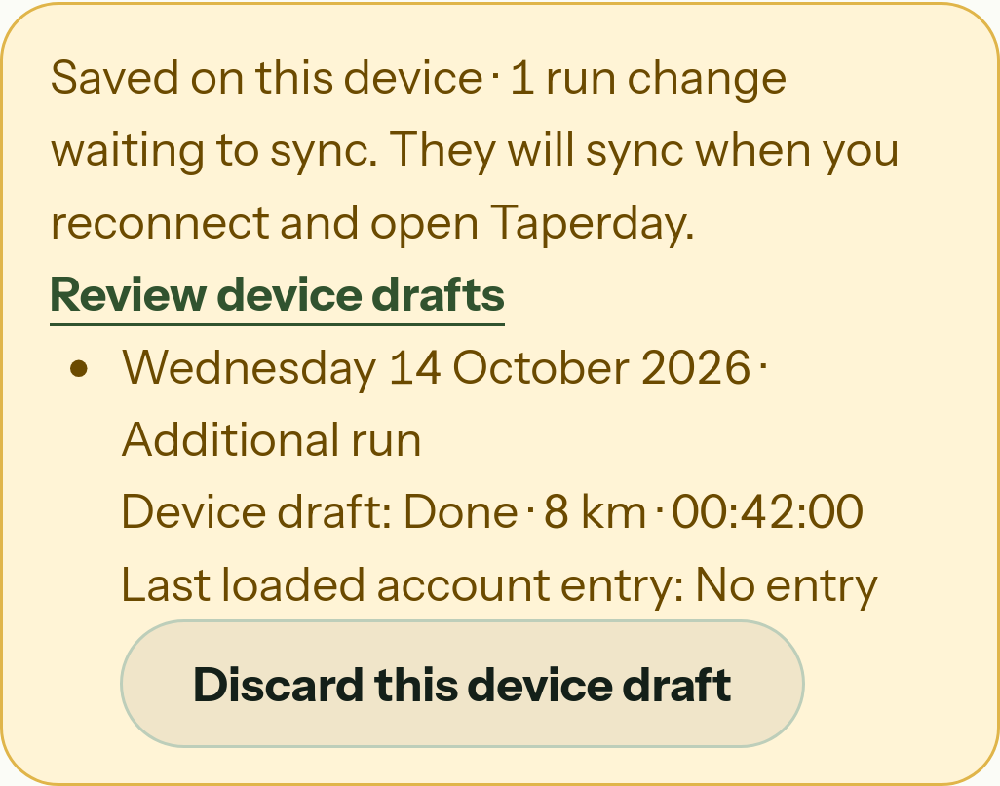
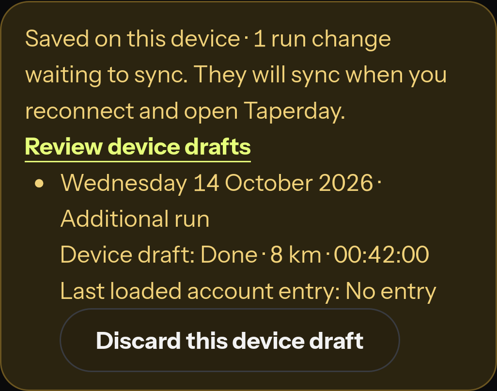
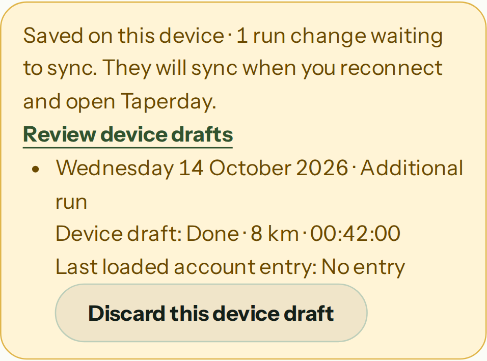
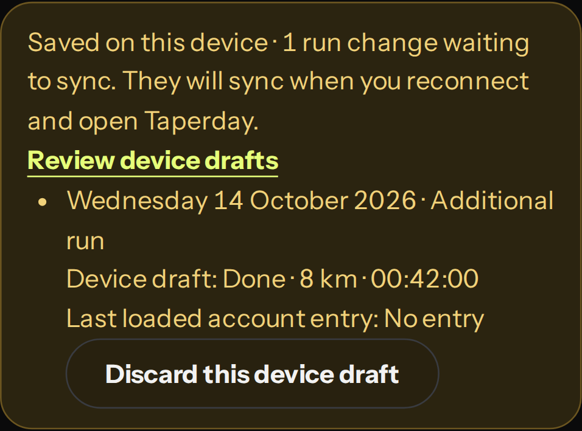
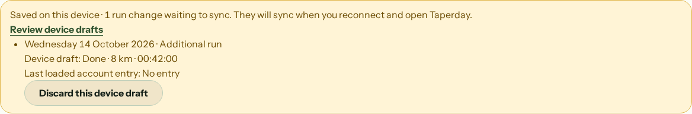
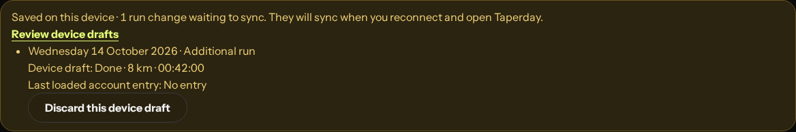

# Saved-plan durability, offline logging and integration validation

Additional work after PR #263, on the same branch. PR #263 was merged by the owner while this follow-up was underway; this work has not been merged or deployed.

## Implementation

- Catalogue plans retain the resolved name/date/distance. Active plans continue to follow catalogue corrections; archiving freezes the latest known details. Past plans and a missing live listing use their snapshot. The additive migration backfills available database and curated race metadata without overwriting an existing snapshot.
- A legacy plan whose race details were never stored and can no longer be found remains visible with `detailsUnavailable`. Its result and existing achievements are retained; the UI does not invent a schedule, training counts or a fresh award. Such lost original details cannot be reconstructed from activity measurements.
- Recent-result distance, time and date now survive saves, reads, edits, replans and export. Adding/removing/changing that performance enables Save. The generated workouts and generator-version snapshots are unchanged.
- Manual run saves/edits/removals survive offline navigation/reload with explicit device-versus-account status. Stable identities, rowversion checks, conflict review, individual draft discard and account isolation and serialized sync requests protect sync. Drafts from replaced plans remain reviewable. Storage errors and rejected API syncs retain the draft/form. Imported measurements are not copied into the offline store.
- Added four browser-engine/device-profile CI jobs and a read-only staging provider configuration report. The latter reports missing configuration and test-recipient/callback isolation without exposing values or sending anything.

## Sequence coverage

| Sequence | Coverage |
|---|---|
| Catalogue save → archive → remove listing → authenticated reload | SQL/API and application tests; same schedule and race metadata. |
| Current calendar correction → archive | Application checks; active follows correction, archived snapshot stays fixed. |
| Legacy snapshot backfill, retained original metadata, unrecoverable listing | Actual migration data operations and SQL/API checks; no invented award. |
| Recent result → preview → save → new client → strength edit → replan → export → remove result | SQL/API plus frontend Save identity regression. |
| Manual offline save → edit → navigate → reload → reconnect → reload | Hook and light/dark browser checks; one stable entry, retained time/distance/note. |
| Failed sync → retry; lost success response → read acknowledgement | Hook checks; retained draft, no duplicate write for an acknowledged match. |
| Another-device edit/deletion → queued save/delete | SQL version checks and browser-hook conflict choice; newer answer preserved. |
| Edit during sync; late refresh; changed account during token acquisition | Hook checks; pending edit retained and stale account cannot submit. |
| Full/blocked device storage; unsynced removal; replaced plan; cancelled sign-out | Hook/authentication checks; no false save acknowledgement or stranded/lost draft. |
| Native PNG/SVG export and share cancellation | Browser-engine suite; native destination checks remain separate. |

## Results

Implementation commit: `925f4bb92ff25dab55b3767689f551a453e4313a`, verified on 15 November 2026. Later evidence-only commits keep the same application code.

| Check | Actual result |
|---|---|
| Backend formatting, strict Release build | Passed; zero warnings/errors. |
| Backend tests | 1,767 passed: Domain 1,216, Application 169, Architecture 7, disposable SQL integration 375; zero skipped. |
| Migration/model consistency | Passed; no pending model changes. The new migration ran on a fresh disposable local database. |
| Frontend lint, forced TypeScript check, production build | Passed. |
| Full frontend suite | 873 tests in 121 files passed locally and in CI. |
| Dependency audit | Zero vulnerabilities. |
| Staging readiness script | Four synthetic configuration/isolation tests passed; live Azure/provider checks are not substituted. |
| Chromium end-to-end | All 200 cases passed in CI, across four shards; no failed or flaky cases. |
| Additional engine/profile suite | 104 passed in CI: 26 each on Android Chromium, iPhone WebKit, iPad WebKit and Firefox. |
| Cached-plan reopen/auth/offline regressions | 46 focused tests passed. |
| Clean phone plan-history sequence | All four source variants passed, including the original strict retained-Strava assertion. |
| PNG/SVG generation, sharing and cancellation | Passed within the 104-case browser-engine suite; portraits remain 1080 × 1920. Native application destinations remain unrun. |
| Accessibility/visual checks | Browser WCAG checks passed in light/dark. Device-draft screenshots inspected at desktop, iPhone and Android profiles. |
| GitHub CI | All ten jobs passed in [run 43679306254](https://github.com/Menzi-Thami/start-line/actions/runs/43679306254). [Secret scan 43679306257](https://github.com/Menzi-Thami/start-line/actions/runs/43679306257) also passed. [Latest PR checks](https://github.com/Menzi-Thami/start-line/pull/264/checks). |

An earlier local full run had one phone history-retention failure while the Vite fixtures were being edited. The unchanged test passed all four source variants on a clean server; all 200 cases then passed on clean CI. The final local full check is run with application sources frozen. Initial test-fixture TypeScript errors were corrected; assertions were retained.

## Visual evidence

All images contain synthetic run entries. iPhone and Android images come from the successful CI artifacts for commit `925f4bb`; desktop captures use the same device-draft UI locally. Mobile screenshots are browser profiles, not physical-device evidence.

| Profile | Light | Dark |
|---|---|---|
| iPhone WebKit |  |  |
| Android Chromium |  |  |
| Desktop Chromium |  |  |

## Remaining access

No physical iPhone/Android/iPad or remote physical-device service is connected. Dedicated live Entra/Strava test identities, a test inbox and opted-in test push devices have not been supplied. Live authorization, provider delivery, installed-device offline behavior and WhatsApp/Instagram native destination checks therefore remain **unrun**, not passed by browser emulation. The staging configuration workflow is prepared for the existing staging environment; it has not been dispatched from this feature branch or used to deploy anything.

The validation request for those account/device identifiers is pending. Automated tests continue to use synthetic accounts and disposable local SQL. See [the live verification matrix](../../integration-validation.md).
