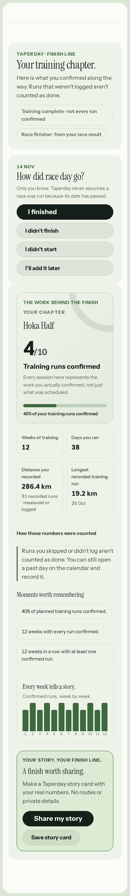
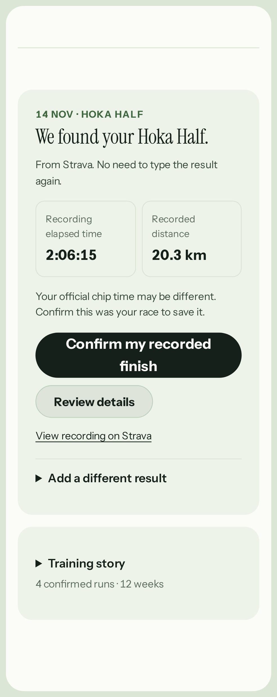
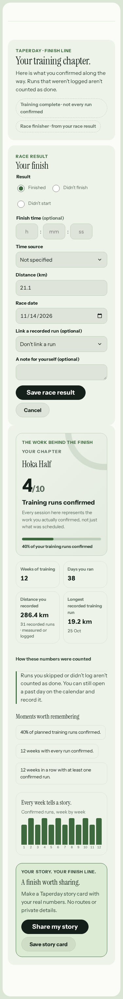
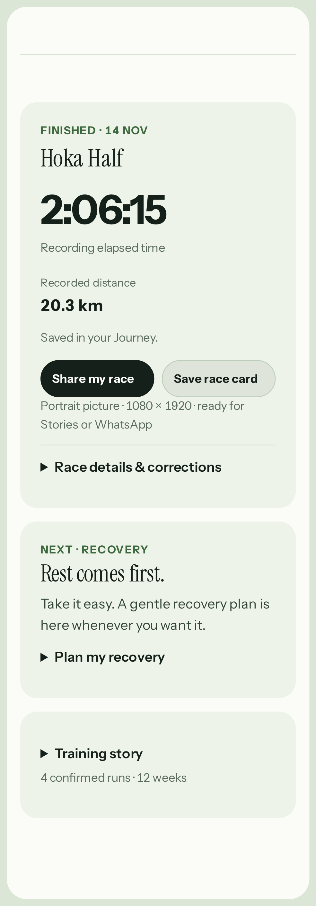

# Race review and automatic recording handoff

Synthetic reproduction of the reported Hoka Half journey: planned half marathon, 14 November 2026, recording 20.3 km with 2:06:15 elapsed and 2:00:00 moving, four confirmed training runs out of ten. No production account or Strava record was accessed or changed.

The baseline screenshots were captured by loading the deployed `e645a67` UI against this same synthetic recording. The old distance tolerance missed it and offered an empty form. Five new regression cases were also run against that revision and failed: automatic Hoka preview, result arriving over each of ask/form/later, and the complete confirmation/review sequence. They pass with the fix.

| Before | After |
| --- | --- |
|  |  |
|  |  |

Additional evidence: [dark phone](saved-phone-dark.png), [desktop light](saved-desktop-light.png), [desktop dark](saved-desktop-dark.png), [actual App with navigation](app-saved-phone-light.png), and [1080 × 1920 race card](race-card.png).

## Regression sequences

| Sequence | Evidence |
| --- | --- |
| Preview → confirm once → celebration → Review my race → saved result → cache expiry → reload | `JourneyReview.test.tsx`, `race-review.spec.ts`; actual request metrics/source, single finisher award and focus asserted |
| Empty ask/form/later → server result arrives | `RaceResultForm.test.tsx`; browser reproduces result arriving over a blank draft, then reviews and reloads |
| Successful save → failed refresh; stale reads and owner changes | `JourneyReview.test.tsx`, existing `useJourney.test.tsx`; saved result remains, no stale blank form |
| Multiple recordings; repeated import; invalid or unavailable detail; retry; leave during load | `race-match.test.ts`, `RaceResultForm.test.tsx`, `finish-line.spec.ts`; choice required, no invented result or late save |
| Correction → conflict; failed save → retry; reload → undo; archived result → recovery | Existing journey unit and browser sequences retained, updated to use visible disclosures |
| Correct chip time after Strava cache purge, on active and archived plans | Two SQL API regression cases fail before the handler fix; existing source link and result ID are retained, a different expired recording or new confirmation without evidence remains refused |
| Saved race in actual App → reveal calendar → Runs → Plan → reload | `PlanFinish.test.tsx`, `race-review.spec.ts`; result stays prominent, training tools remain reachable |
| Light/dark, 320/375/820/1440 pixels, optional recovery preferences, keyboard focus | Axe WCAG 2.2 AA and no overflow checks in `race-review.spec.ts`, alongside the existing finish-line width/theme matrix |
| PNG → SVG fallback; prepared native file share in user gesture | Actual binary dimensions/signature and exported metrics checked, no planned-distance substitution |

Run the complete `scripts/check.sh` and `npm run e2e:connections` before review. The PR records the final counts and CI links for its tested revision. Screenshots are generated by Playwright’s synthetic fixtures; physical devices, native destination apps and live Entra/Strava sign-in are outside these automated checks. A same-day similar-length training run can still be a suggestion; confirming it remains the runner’s choice. Missing or expired data that was never saved cannot supply an official chip time. No backend schema or generator change is required.
