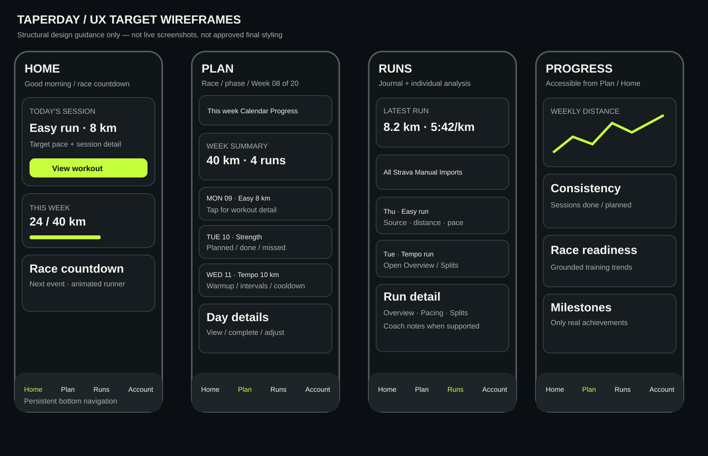

# Taperday — design-to-code visual contract (companion to CLAUDE_UX_HANDOVER.md)

**Interpretation:** The SVG is a newly authored **structural wireframe**, NOT a screenshot of staging and NOT a new colour/font design system. Use the actual Taperday tokens, components and runner illustrations. The existing staging code is the authority for visual identity. The diagrams indicate information hierarchy and navigation intent, not pixel-perfect styling. Do not use stock imagery or generic fitness templates.

## 1. Agent execution protocol: no guessing
1. **Inventory current routes/components** and identify the *actual* previous bottom navigation implementation from git history. Current evidence: `client/src/features/runner-home/Home.tsx` already supports `onOpenPlan`, `onOpenDay`, `onOpenProgress`, `onOpenRun`, `onOpenRuns` and `onOpenAccount`; `client/src/features/plan/PlanView.tsx` already contains `This week`, `Calendar`, `Progress` tabs and a separate `StrengthTab` integration. Account settings already live in `client/src/features/account/AccountPage.tsx`. **Reuse rather than recreate.**
2. Produce a **route-to-screen inventory** with screenshots and source references. Distinguish **existing / partial / missing / broken / unverified**. Explicitly inspect current app shell, bottom bar, navigation state and responsive CSS before changing it. Never assume the bar is absent solely because the user says they miss the earlier version.
3. For each screen provide a **before** screenshot, a **target composition** using existing tokens, and an **after** screenshot. Get user design approval for the shell, Home, Plan and Runs before rolling changes through every screen. A passing unit test is not design approval.
4. If a requirement conflicts with working existing functionality, surface the conflict with a proposed resolution. Do not silently remove tabs, strength views, profile features or onboarding.
5. Avoid design invention: do not choose a different palette, font, runner art, new visual language or different information architecture without approval.

## 2. Navigation interaction contract
### Phone, including installed PWA
- Primary persistent bottom bar: **Home | Plan | Runs | Account** with icons + text labels, clear selected state and original Taperday styling. This is a **proposed label mapping**; before implementation, compare to historical bottom-bar labels and retain the user's actual familiar configuration where practical.
- **Progress** is directly accessible from Plan's Progress tab and a Home progress-card action. It must never be buried in Account. If original bottom bar had Progress as a top-level destination, document the difference and ask user before removing it.
- Minimum 44x44 CSS px touch areas; focus-visible; correct `aria-current`/semantic navigation; safe-area padding; content bottom padding; no overlap with floating Continue, calendar, modal or keyboard.
- Switch top-level destinations without accidentally resetting selected plan week, losing builder input, or scrolling to an unrelated position. Inner detail screens have a clear Back action that returns to the originating context.
- Don't display the bottom bar on immersive build-film scenes if it interferes with storytelling; return immediately afterward. Specify and test where it is hidden.
- Tap a current destination: stay there (avoid unnecessary rerender); deep links resolve to correct tab; refresh preserves intended view where supported.

### Desktop and tablet
- Do not simply scale the phone card column to 1440/2560px. Use a bounded main content container and intentional two-column compositions for Home, Plan, Runs and Progress.
- Desktop navigation can adapt to sidebar/header **only if it retains all four destinations and consistent order/labels**. Don't introduce a second competing navigation bar. The user should be able to reach any primary destination in one action.
- At 768–1024px test landscape/tablet behavior explicitly, including calendar and sticky overlays.

## 3. Layout anatomy / component contracts
### Home
1. Header: concise greeting / current plan / next race, without a giant empty hero.
2. Dominant next-session card above the fold: workout type, distance/duration, day, intensity and **View workout**. Completed state changes to achievement and runner illustration without moving the navigation.
3. Secondary grid: weekly progress, race countdown, recent run/sync status. Mobile stack in priority order; desktop two-column grid.
4. Optional coaching, readiness, milestones and calculators stay discoverable but must not push the primary action below multiple screens.
5. No-plan state: build a plan and explore goals; offline/stale-plan states explain what remains usable.

### Plan
1. Header with race goal, date, week number, training phase, week-jump control.
2. Visible `This week | Calendar | Progress` sub-navigation; preserve existing swipe/tab semantics and Strength feature access.
3. Week summary then chronological seven-day cards with day/date, workout type, expected distance/effort, status, completion source where available. Rest days visible.
4. Selecting day opens detail without losing week scroll/selection. On desktop show list/calendar and day detail side-by-side if space allows.
5. Calendar: every day visible and selectable, with disabled dates readable; race week clearly distinguished. Correct Monday/Sunday boundaries and local date behavior.

### Workout detail / completion
- Header date/type/phase, structured workout segments and effort/pace, planned vs actual, strength exercises where relevant, coach notes, Complete/Edit action.
- Completion state includes original runner animation, supportive copy for deviations, Strava source and optional effort/note. Distinguish pending sync from completed; never fabricate metrics.
- Back returns to same week/day; no duplicate completion on repeated import.

### Runs
- Summary latest activity, accessible journal filters and chronological activity rows.
- Each row shows date, distance, pace if present, source and matching plan session if known.
- Detail sub-navigation `Overview | Pacing | Splits | Coach insights` **conditionally** renders tabs only where data exists; missing GPS/splits/HR display a neutral unavailable message, not empty charts.
- Desktop: journal list left, selected run detail right; phone: list then detail.

### Progress
- Top summary of consistency and weekly distance, trends below, milestones and optional advanced analysis. Each chart has units, time period, textual interpretation and no fabricated claims.
- Progress within Plan can route to this richer view or share the same underlying component; **do not create two inconsistent metrics sources**.
- Empty state explains how to record first run; no empty chart grid.

### Account
- Profile header, clear groups for Connections (Strava), Notifications, App & calendar, Shoes, Data & privacy and sign out.
- Existing expand-in-place settings and callbacks remain authoritative; do not build parallel forms. The app must return to the user's plan/home after sign-in.

### Race builder
- Goal-first custom race, then animated race catalogue; selected race visibly persists across steps. Continue fixed/reachable but yields to sheets.
- Start date and training days are distinct concepts; review summarizes actual submitted values.
- Full original five-scene film on new plan creation; loading/error and reduced-motion states explicitly designed.

## 4. Visual QA reference grid
| Screenshot ID | Screen/state | Phone 390 | Tablet 768 | Desktop 1440 | Wide 2560 | Dark/light |
|---|---|---|---|---|---|---|
| S01 | Home next workout | ✓ | ✓ | ✓ | ✓ | both |
| S02 | Home no-plan/completed | ✓ | — | ✓ | — | both |
| S03 | Race catalogue/custom | ✓ | ✓ | ✓ | — | both |
| S04 | Builder step/review/calendar | ✓ | ✓ | ✓ | — | both |
| S05 | Plan week | ✓ | ✓ | ✓ | ✓ | both |
| S06 | Plan calendar/month-end | ✓ | ✓ | ✓ | — | both |
| S07 | Workout detail/completed | ✓ | ✓ | ✓ | — | both |
| S08 | Runs journal | ✓ | ✓ | ✓ | ✓ | both |
| S09 | Run detail | ✓ | ✓ | ✓ | — | both |
| S10 | Progress charts/empty | ✓ | ✓ | ✓ | ✓ | both |
| S11 | Account settings | ✓ | ✓ | ✓ | — | both |
| S12 | Strava notification/sync | ✓ | — | ✓ | — | both |
| S13 | Bottom nav + sheet overlap | ✓ | — | — | — | both |
| S14 | Build film frame(s) | ✓ | — | ✓ | — | both |

Also capture **320px** overflow/accessibility checks and test reduced motion. `—` means optional screenshot, not optional functional support. Attach named before/after images in implementation PR and a short reviewer checklist; link to a downloadable CI artifact if image upload is impractical.

## 5. State and transition specification
| Trigger | Expected response | Must not happen |
|---|---|---|
| Tap bottom Plan | Current plan / week view | Restart builder |
| Tap workout card | Structured day detail | Lose week position |
| Complete run | Done state, runner animation, progress updates | Double-count activity |
| Strava run arrives | In-app notice, matched day ticks | Spam or false matching |
| Choose race | Selected state, Continue reachable | Scroll to hidden CTA |
| Open date sheet | Full calendar accessible | Sticky CTA covers final week |
| Build plan | Original complete running film + real API | Premature navigation, pause/next tip |
| Plan API fails | Inline retry preserving answers | Reset all steps |
| Toggle theme | Contrast/visual identity maintained | Invisible race bib text |
| Reduce motion | Immediate accessible state changes | Forced 6-second wait |
| Desktop resize | Intentional grid, readable max width | Vast blank unused space |
| Navigate back | Previous meaningful context | Return to onboarding |

## 6. Acceptance process and explicit stop gates
**Gate A — design approval:** provide baseline screenshot collage, target wireframes rendered using **existing Taperday styling**, and exact navigation mapping. User confirms before broad implementation. The SVG here is a specification aid, not a substitute for this approval.

**Gate B — functional implementation:** shell and Home/Plan/Builder/Workout journeys complete with tests and screenshots. Show side-by-side visual changes; do not proceed to polish until primary journey accepted.

**Gate C — full screens:** Runs, run detail, Progress, Account and all states implemented, no duplicate sources of truth.

**Gate D — release:** security scan, lint, typecheck, frontend/backend tests, Playwright journeys, browser screenshots, manual Safari and desktop review, staging smoke. User approves staging. **No production deployment without separate explicit instruction.**

## 7. Agent deliverables
- `docs/ux/implementation-gap-matrix.md` with route/component references and verified status.
- `docs/ux/decisions.md` with user-approved design decisions and explicit deviations.
- Screenshot index and actual PNG evidence for each screen/state (or linked downloadable CI artifacts).
- Staging-targeted feature PR(s) with test results, browser matrix, before/after, outstanding risks and manual QA notes.
- A concise **“what changed / what remains / how to test”** handover; never assert full acceptance without user sign-off.
