# Taperday visual boards

These are newly authored SVG **structural concepts** (not screenshots and not the exact image-search illustrations shown in chat). They document the information hierarchy for all 11 screen families and should be translated into the actual original Taperday design system. The original running cartoon and animations must be reused from the app, not recreated from these boards.

## 1. welcome goal

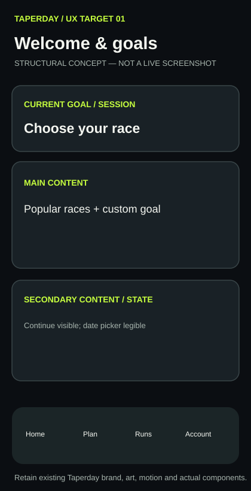

Welcome → choose popular or custom race → target/date; preserve animated race bibs and visible Continue

## 2. plan builder

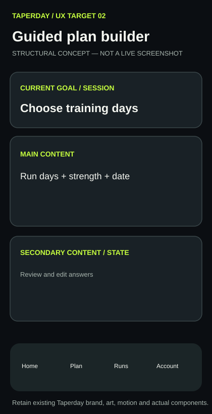

One question per step: baseline, goal, running days, strength, start date, review/edit

## 3. plan generation

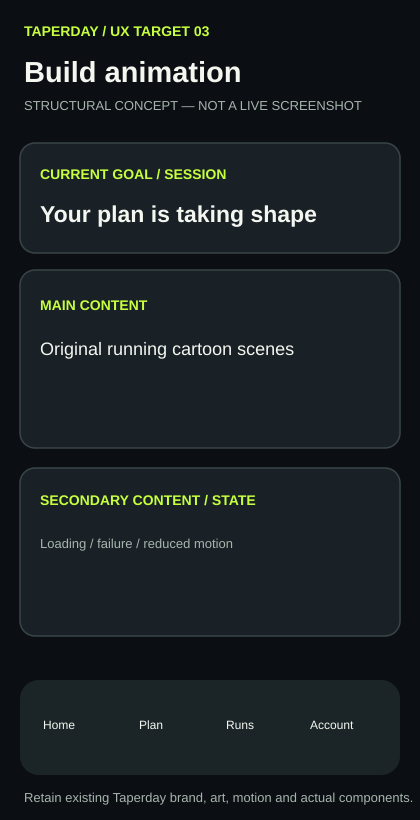

Full original five-scene runner movie while API generates; reduced-motion path and retry

## 4. home dashboard

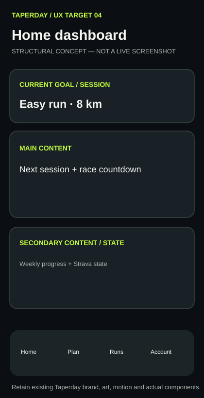

Next workout above fold, week mileage, race countdown, sync state and animated runner

## 5. weekly plan

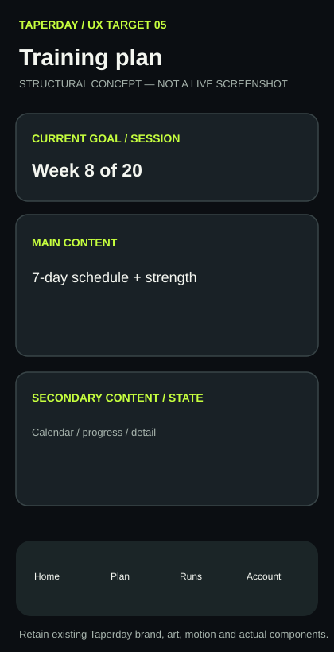

Week number, This week/Calendar/Progress, seven complete days, strength and selected detail

## 6. workout completion

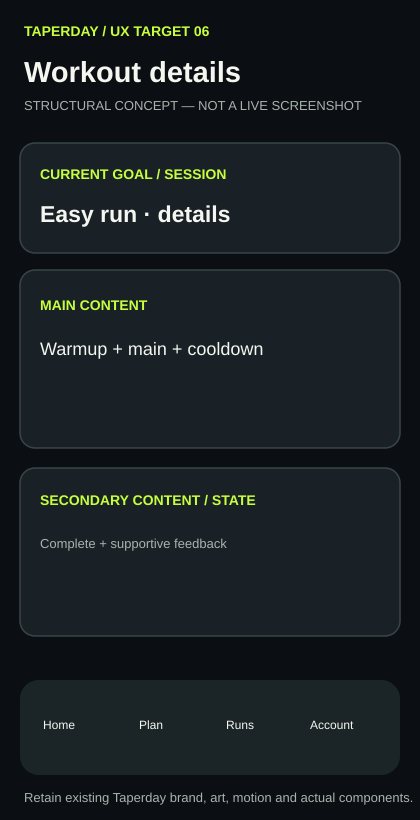

Warmup/segments/effort, complete/check-in, Strava auto-match, supportive short/long messaging

## 7. runs journal

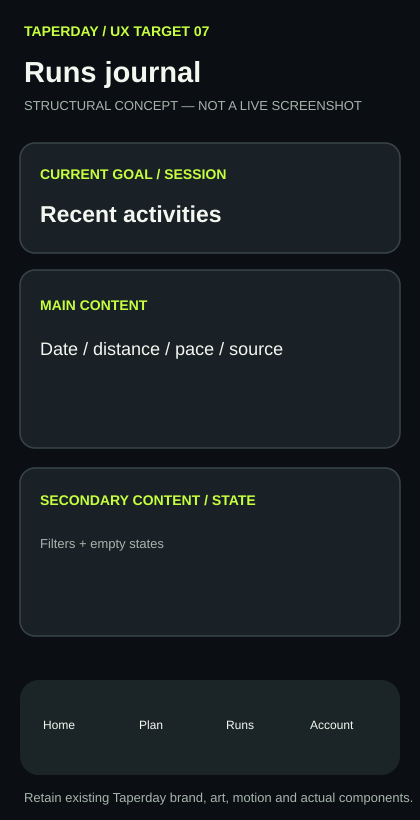

Chronological activity history, filters, source labels and run details

## 8. run analysis

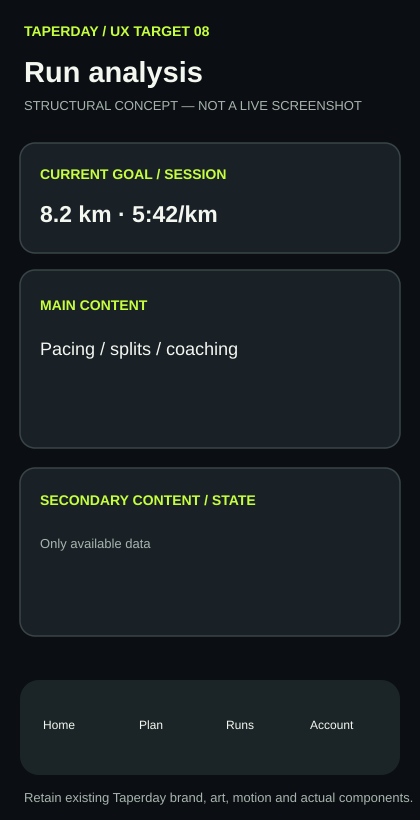

Overview/Pacing/Splits/Coach only if data supports it; no invented charts

## 9. progress insights

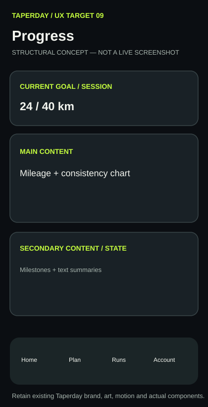

Weekly mileage, consistency, trends, milestones and text equivalents

## 10. account settings

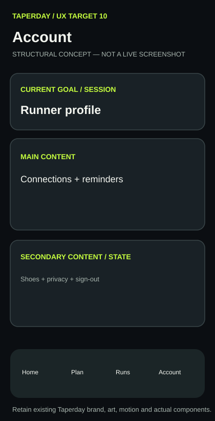

Profile, Strava, notifications, PWA/calendar, shoes, privacy and sign-out

## 11. desktop layout

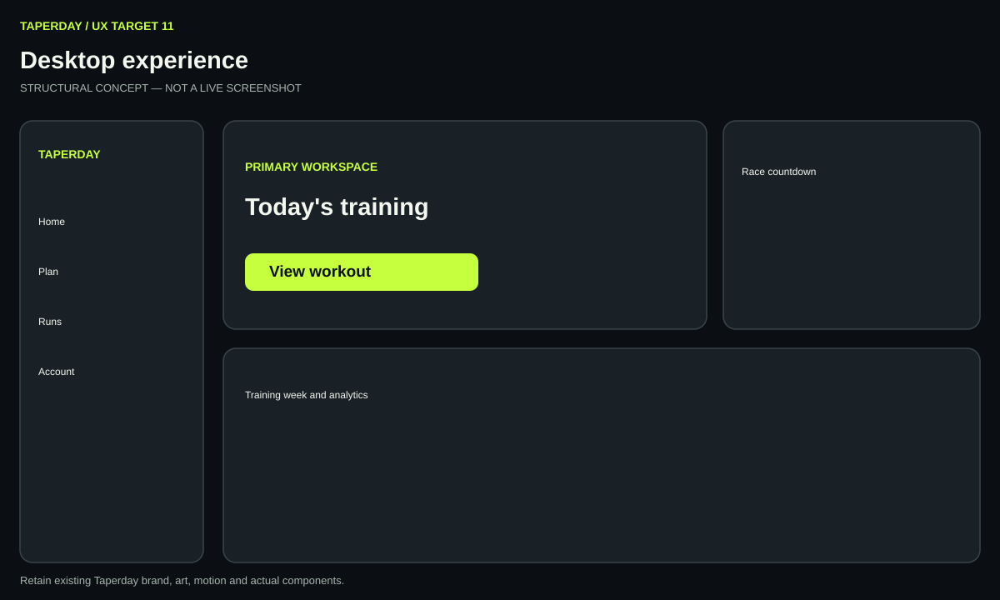

Desktop purposeful two-column grids, consistent navigation, no wasted canvas

## Evidence and acceptance

See [full UX handover](../CLAUDE_UX_HANDOVER.md), [implementation contract](../DESIGN_IMPLEMENTATION_CONTRACT.md), and linked genuine Playwright artifacts. Claude must extract actual screenshots, compare before/after, seek visual approval, and preserve the original bottom navigation and theme.
